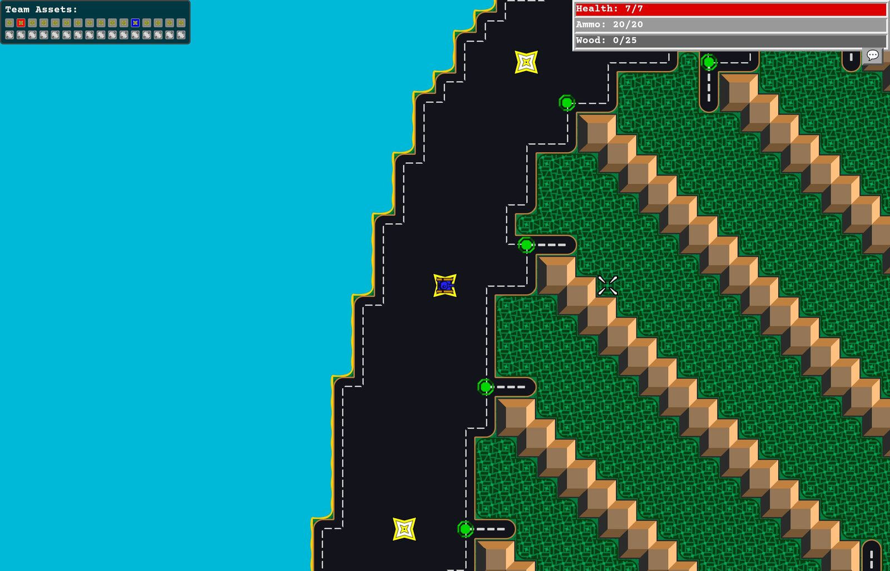

+++
title = "Tank War 2000: vibe coding a multiplayer tank game for a game jam"
description = "Building an authoritative-server multiplayer tank game with Claude Code in three weeks for the 2025 Vibe Coding Game Jam, and what I learned about steering an AI coding agent."
date = 2026-10-16

[taxonomies]
tags = ["game dev", "AI", "TypeScript", "multiplayer", "Phaser"]

[extra]
toc = true
+++

*How I built a real-time, team-based multiplayer tank game in about three weeks, with an AI writing nearly all of the code, and how most of my actual job turned out to be architect, debugger, and occasional bouncer.*

**[Play it in your browser](https://fletcher.cool/tank-war-2000/)** • **[Source on GitHub](https://github.com/FletcherD/tank-war-2000)**

---

The 2025 Vibe Coding Game Jam had an unusual rule: the game had to be **at least 80% written by AI**. It also had to be free, playable instantly on the web with no logins or loading screens, and hosted on its own domain. I wanted to find out what Claude Code could do on something bigger than a script, so I went big: a **multiplayer** game, with an **authoritative server**, **client-side prediction**, and a destructible, buildable map.

The game is a loose remake of **Bolo**, Stuart Cheshire's classic networked tank game from the BBC Micro and early Macintosh days. The design, in one paragraph: two teams of tanks fight over a tile map. You capture neutral **stations** by sitting on them, and that's also where you resupply your limited ammo. **Pillboxes** are automated turrets that shoot the nearest enemy, and you can pick them up and carry them to a new spot. You harvest **wood** from forests and spend it to build **walls** (to block enemies) and **roads** (to go faster). Forests also hide you from the enemy. Capture every station and your team wins.

I kept a copy of every Claude Code session as I went, and those transcripts, plus 214 commits, are what this post is built from. It's an honest account, including the parts where the AI went off the rails and the parts where I did.

---

## Act I: A tank in a tutorial

I didn't start from zero. Colyseus, the multiplayer framework I picked, has an official Phaser tutorial project by its author, Endel Dreyer, and the first 22 commits in my repo are his. On **March 18** I committed "Adapted Phaser/Colyseus tutorial to Tank Game", and five minutes later "Add Claude".

The first few days were single-player: tank controls, tread sprites, collision groups, and a fight with physics that ended with a switch to Matter.js and the commit **"finally proper sliding along walls"**. Then a tileset with **Wang tiles** (auto-joining terrain edges so water meets grass in a smooth coastline) committed at 2:35 AM, per-tile speed modifiers, bullets, and destructible walls. By March 22 there were pillboxes that **lead their target** (predict the travel time from distance and bullet speed, multiply by the tank's velocity, aim there), stations, and an HTML/CSS HUD in a monospace font laid over the game canvas.

The first real bug was a good warm-up. Bullet range was set to 4096, but bullets died after about 16 tiles. I asked Claude: *"is there a unit mismatch somewhere?"* There was. The tank's speeds were commented as "meters/msec", the bullet was being treated in pixels, and the fix was to track an explicit distance-travelled counter.

### The Parcel loop

The first warning sign about working with an agent came from something boring: getting the bundler (Parcel) to handle image assets instead of me copying them into `dist/` by hand. Claude tried four approaches in a row:

1. Moving assets into `src/` and telling me Parcel would now bundle them. *"the asset files still aren't being processed by parcel."*
2. Importing the PNGs as ES modules. Phaser's loader crashed with `file.url.match is not a function`, because Parcel's JSON import hands back an object, not a URL string.
3. A static-file-copy plugin with a `static/` directory, "a common pattern used by many Phaser and game dev projects." That produced 404s and a MIME-type error.
4. A `public/` directory instead, with a script-tag change that caused "Browser scripts cannot have imports or exports", an error it had just introduced itself.

Every one of those replies ended with some version of *this should resolve your issues*. None of them had been run. It got there eventually, but this was the pattern I'd learn to watch for: confident and fast is not the same as verified.

---

## Act II: Splitting the game in two

A multiplayer game with an authoritative server needs the *same* game logic running in two places: on the server (which decides what really happened) and on the client (which predicts what's about to happen so your own tank feels responsive). So the code had to be split into `shared/`, `client/`, and `server/`.

This took **three attempts**, and the difference between them is the most useful thing I learned about prompting.

- **Attempt 1:** "how can i accomplish this?" Claude rewrote Tank and Bullet, rewrote the server room, and wrote a README twice. I threw it away.
- **Attempt 2:** "the client and server should contain as little game logic as possible." Claude built an elaborate `common/` package with its own GameObject model, a CollisionManager, a GameState manager, and more READMEs: 733 lines for a refactor I didn't want. Thrown away.
- **Attempt 3:** *"don't change the code any more than necessary; it should still use the phaser engine and run exactly the same."* This one moved the files, fixed the imports, and stopped. It stuck.

The goal was the same all three times. Only the scope language changed.

### Headless Phaser, and an agent that loves a mock

The server has to run the real Phaser physics with no browser, using Phaser's `HEADLESS` mode. For the proof of concept I said *"don't go wild with refactoring yet"*, and Claude's solution was to **hand-build a fake Phaser scene** on the server (`this.gameScene.add = { existing: ..., sprite: () => ({setVisible(){}, setFrame(){}}) } as any`) and to switch off TypeScript's `strict` mode when the compiler complained.

I stopped it ("**wait.** we also need to make some changes to the server to run in headless mode…") and proposed a proper `ServerGameScene`. Claude agreed, and its own reasoning even admitted we'd "avoid the hacky mocks I was implementing". Then Phaser crashed with `window is not defined`, because it pokes browser globals at import time even in headless mode, and Claude's response was… a 99-line `global-mock.ts` faking `window` and `document`. I rejected the commit.

On **March 24** I committed **"start over with server _again_ this time with colyseus example project"**, and just after midnight, "update server package versions, fixing annoying headless phaser bug". The fix for headless Phaser was a version bump, not a pile of mocks.

### The architecture that held

The one design decision that carried the whole project came from a "don't write any code yet. think." conversation. I asked: what if the client and server each have **derived classes** of the shared game objects? `Tank` lives in `shared/` with all the movement and physics. `ServerTank` extends it and knows how to write its state into a Colyseus schema. `ClientTank` extends it and knows how to read state from the schema, interpolate, and render. The same goes for `ServerPillbox`/`ClientPillbox`, `ServerStation`/`ClientStation`, and `ServerGameScene`/`ClientGameScene`.

Claude's first instinct, when I asked it to sync pillboxes next, was to update their schemas from the scene's `update()` loop. I pointed back at the pattern ("this is the same approach we're using for the Tank"), and from then on every new object followed it. By the early morning of March 25 the client was connecting, the server was spawning tanks, and at 3:40 AM I committed "client prediction".

Not every bug got a root cause. When `this.room` was undefined in `ServerGameScene.create()`, I asked *"why is this.room uninitialized at this point?"*, and Claude wrapped the code in a guard and a try/catch and called it a "timing issue". That hides the symptom without fixing anything. A later commit, "ServerGameScene is created with room", restructured the creation order properly.

---

## Act III: The plan-first rhythm

By March 26 I'd settled into a rhythm that I'd keep for the rest of the jam:

1. `/clear` the context.
2. Describe one feature, ending with *"consider how to implement this. don't write any code yet. think."*
3. Read the plan, correct it.
4. *"go ahead and implement it."*

It was fast. On the evening of March 26 the commits are 20 to 40 minutes apart: pillbox damage tint, station capture, pillbox pickup, pillbox placement, a placement fix, a state-transition fix, ammunition, and a newswire (a scrolling game-event log).

The correction step mattered more than I expected. For pillbox pickup, Claude's plan stored the player's selected tile on the tank schema. I pointed out we'd *already built* tile selection for roads, so it should reuse that, and I named the states myself: placed, pickup, held. When it worked: *"excellent, it's working."* And after placement: *"excellent! it works fantastically. just a couple small issues."* (The pillbox was landing one tile right and one tile down from the selection, because the selection rectangle's origin was its center.)

### The human found the bugs

Two bugs from that night are good examples of how the debugging actually split up:

- **The ghost pillbox.** After picking up a pillbox, the new sprite sometimes didn't appear. I turned on Phaser's physics debug drawing and could *see* the problem: an invisible physics body left in the world where the pillbox used to be. Once I described that, Claude fixed it immediately, fully recreating sprites and bodies on every state change.
- **Ammo that wouldn't go down.** *"on the server, i see the ammo decreasing properly: "ammo left: 18" etc. on the client… it's always 20. what's going on?"* The cause: the server copied each tank property into the synced state one field at a time (to trigger change detection), and nobody had added `ammo` to the list. It was a one-line fix, and a lesson about hand-maintained sync lists.

In both cases I did the observation and Claude did the code search. It's very quick at turning a precise symptom into a cause, and much less good at producing the precise symptom itself.

### Four tries at building a road

Networked road building was the messiest stretch of the project. I wanted something simple: the client asks the server to build a tile, the server changes the map, and everyone sees the change. Claude kept building client-side machinery: Wall entity classes with their own schemas and health, build-progress messages, cancel requests, result callbacks. It also used tile index 192 for walls in one attempt and 320 in the next.

I cleared and re-prompted **four times**, each time with a stronger constraint: *"the client doesn't have any road building functionality - it simply receives map schema change events from the server."* The fourth version, planned before any code was written, finally matched. Then Colyseus threw `Can't access 'tileIndices' through callback proxy`, and that got fixed in one step because I'd cloned the **Colyseus docs into the repo** and pointed Claude at them.

And then I threw out the schema approach anyway: *"since this isn't state, let's use a broadcast message."* Map tile changes became a plain `tileChanged` broadcast, and building finally worked. I generalized `buildRoad()` to `buildTile()`, and the jam got walls for free.

### Steel, I mean wood

Not every rewrite was the AI's fault. I asked for **steel** as a resource, dropped by destroyed walls and tanks and drawn as a white circle sized by its value. Claude built all of it: `Steel`, `SteelSchema`, `ServerSteel`, `ClientSteel`, decay timers, costs. Then I changed my mind, cleared it, and redesigned it as harvesting forest tiles, followed by the shortest design document I've ever written: *"replace "steel" with "wood"."*

This is underrated about building with an agent: a feature redesign costs minutes, not days. You can build the wrong thing, play it, and throw it away.

---

## Act IV: Netcode at 4 AM

Client prediction got rebuilt more than once. On March 29, between 2 and 5 AM, I swapped in snapshot interpolation from the geckos.io library for other players' tanks and reworked prediction for my own. The tread animation broke under reconciliation and had to be fixed the next day. A week later I rebuilt reconciliation again around one idea: track the offset between the last authoritative server state and where the player *was* at that moment, and correct by that ("much smoother", says the commit).

The last few days of March added chat (team chat by default, `/all` to everyone, and a fix for the game eating spacebar presses while you type), player names, a server-address URL parameter, and touch controls with a nipplejs joystick. When Claude went looking for icon files for the build menu, I told it *"i don't have any icons right now, just use emojis or unicode symbols"*, which is why you build roads with 🛣 and walls with 🧱 and harvest with 🪓.

I also redesigned the input model myself: from four booleans (up/down/left/right) to analog `turn` and `forward` floats, so the joystick and keyboard share one path. Later this became a `targetHeading` that the shared Tank class steers toward, so prediction and server agree on turning. That's the kind of design decision the agent executed well but never proposed.

---

## Act V: Deploy day

**April 1** was the deadline, and it has 60 commits. It's the most chaotic day in the repo, and it's mostly not game code.

The plan was a GitHub Pages client talking to a server on **Colyseus Cloud**. Problem one: the cloud build runs `tsc`, and my dev setup had never type-checked strictly. Thirty-odd errors. Claude fixed them the way an agent under pressure fixes things: `any` annotations, `@ts-ignore`, a `types.d.ts` that bolted `any`-typed fields onto Colyseus and Phaser classes, and in one case just deleting an assignment it couldn't type. The commits from the small hours read "use webpack" at 2:47 AM, "do not use webpack..." at 3:00, and "try to fix tsc" at 4:15.

Problem two arrived that afternoon: the game page on github.io is HTTPS, and the browser refused to talk to a plain `http://…:2567` server. Mixed content. I told Claude:

> *"colyseus cloud doesn't seem to support https for the server, while github.io is on https. this is seriously frustrating and there are now only a couple hours left in the game jam lol. i need to get this hosted somewhere quickly"*

Its answer was a scattershot list of hosting providers, an offer to rewrite the game as peer-to-peer, and unrequested edits that routed traffic through a public CORS proxy and added a CSP tag commented "Allow mixed content" (that directive does the opposite: it upgrades requests to HTTPS). My last prompt of that session was a bare `git restore`.

The rest I did by hand, and the commit log tells the story better than I can: "allow mixed content", "allow mixed content", "ppppppp", "don't specify protocol", "qqqqq", "don't mess with server url". What finally worked was *removing* things. I stopped building the server with `tsc` and ran the TypeScript directly with `tsx`, ripped the tutorial's leftover latency-simulation code (the source of that first blocked request) out of the client, and reduced the connection logic to "use the server address from the URL parameter".

Then I went right back to features that evening: respawning, all pillboxes starting as pickups, a win condition, a welcome screen, and mobile layout fixes. The "start as pickup" change is a nice small example of ripple effects. Claude flipped the schema default, which broke pickup (pickup physics were only set up on conversion), and fixing that broke *placed* pillboxes (they now also defaulted to pickup physics). One sentence of request, two regressions.

---

## Act VI: Juice, and a rollback

The jam had over a thousand entries and mine didn't place, which is fine. Having a real deadline on a personal project turned out to be the fun part, and people were still trickling in from the entry list, so the week after the deadline was polish for them. Analog steering, team auto-balancing, tanks hiding properly in forests, "X was destroyed by Y" messages, a white flash on damage, and a quick white circle when a bullet hits. That last one got the happiest message in the whole log:

> *"it's perfect! now add a similar animation for when a tank or pillbox is destroyed. use the exact same white circle animation, but larger and slower"*

The same week had the clearest lesson of the project. I asked for three things in a row: WASD support with a platform-specific welcome dialog, unique player names, and then a fix for the desktop dialog showing nothing after "Controls:". Claude added user-agent sniffing in three places. Then, on connect: *"how bizarre - now the client gets this error on connect: … Cannot read properties of undefined (reading 'x')"*. Instead of finding the cause, it added fallbacks: spawn at any station, or failing that at (100, 100).

When an agent starts writing fallbacks around an error it can't explain, it's lost the plot. I cleared everything and re-asked a much smaller version: just put the controls text in the dialog, no platform detection. That's the version in the repo. Unique player names never made it in at all.

The last commits, around April 10, switched the game to 32-pixel tiles and fixed scaling on high-DPI screens.

---

## Epilogue: Single-player, 18 months later

The Colyseus Cloud server cost money every month, and by 2026 nobody was playing. But I still wanted the game to be playable as a portfolio piece. So in September 2026 I opened a new Claude Code session and asked: *"when someone navigates to [the game] … they should drop into a functional game running only on the user's pc. no server connection, and obviously no other players… there were no players left anyway"*.

This session went very differently from the 2025 ones, partly because the tool had improved a lot and partly because I'd learned how to work with it. It explored the codebase with parallel sub-agents, asked me three scoping questions (full sandbox or just driving? offline by default? skip the name prompt?), and proposed a design I really like: don't port the server logic to the client, **run the real server in the browser**. A `LocalRoom` class impersonates a Colyseus room. It boots a second, headless Phaser game running the actual `ServerGameScene`, and feeds its state to the completely unchanged client through an in-process Colyseus encoder → decoder loop. The client can't tell the difference.

There was one good bug. The page came up as a solid cyan screen with `Cannot read properties of undefined (reading 'setRoot')`. Claude's first theory, that the bundler had stripped the schema decorators, was wrong. The real cause was that **two copies of `@colyseus/schema`** were being bundled (one from `server/node_modules`, one from `client/node_modules`), and schemas track changes with a module-local `Symbol('$changes')`, so the two copies' symbols never matched. A bundler alias pointing both at one copy fixed it.

It then tested the game itself by driving a real Chrome window, firing until the ammo ran out, harvesting wood, and getting the tank "genuinely wedged in a concave coastline pocket" before giving up and reloading for a better spawn. The first GitHub Pages deploy failed because CI only installs the client's dependencies, and the reused server code imports `uuid`. Claude reproduced the CI environment locally by moving `server/node_modules` aside before pushing the fix. About 78 minutes after my first prompt, the single-player version was live. Online play still works if you pass `?server=` in the URL.

---

## What I learned

**Scope words are the steering wheel.** "How can I accomplish this?" got me a rewrite. "Don't change the code any more than necessary" got me the change I wanted. The agent will fill whatever space you leave it.

**"Don't write any code yet. Think."** This was the most valuable sentence in the project. Plans are cheap to correct, and code isn't. Nearly every bad design (selection stored on the tank, Wall entities with health, client-side build machinery) was caught at the plan stage.

**The architecture has to come from you.** Derived client and server classes, server-only bullets, broadcasts for tile changes, analog input, target headings: the decisions that made the codebase hold together were mine, and the agent was excellent at carrying them out across a dozen files. Left to its own judgement, it reached for the quickest hack.

**Watch for the signs of an agent that's lost.** Mocks, `any`, `@ts-ignore`, try/catch around a mystery, fallbacks to (100, 100), and "this should resolve your issues" before anything has run. When those show up, don't keep patching. Revert, clear, and ask for something smaller.

**You still have to look.** Phaser's debug draw, comparing server logs to client messages, playing the game on a phone. The agent turned good observations into fixes in minutes, but the observations were usually mine.

**Throwaway is cheap now.** Steel → wood, four attempts at networked building, an entire feature reverted. When an implementation costs ten minutes, you can afford to build things just to find out they're wrong.

The game is at **[fletcher.cool/tank-war-2000](https://fletcher.cool/tank-war-2000/)**. It's single-player now, so the stations are yours for the taking.
