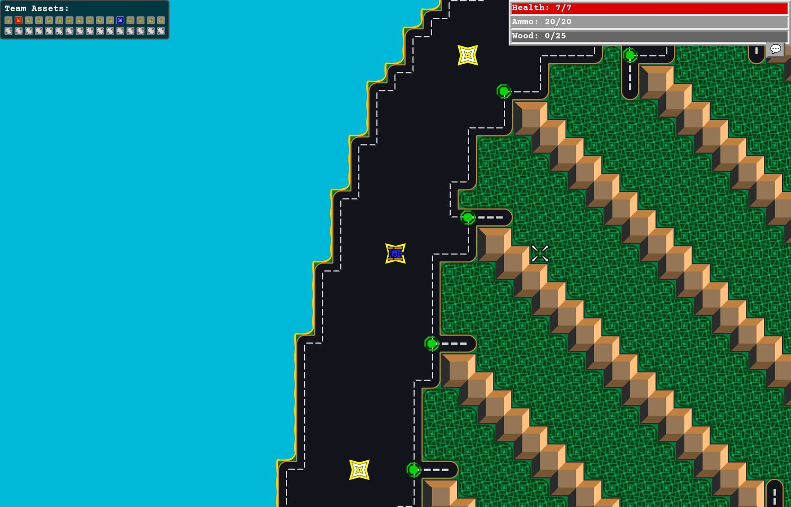

+++
title = "Tank War 2000: a multiplayer tank game for the 2025 Vibe Coding Game Jam"
description = "Notes on building an authoritative-server multiplayer tank game with Claude Code in about three weeks, and on converting it to single-player later."
date = 2026-10-16

[taxonomies]
tags = ["game dev", "AI", "TypeScript", "multiplayer", "Phaser"]

[extra]
toc = true
+++

**[Play it in your browser](https://fletcher.cool/tank-war-2000/)** • **[Source on GitHub](https://github.com/FletcherD/tank-war-2000)**

The 2025 Vibe Coding Game Jam required games to be at least 80% written by AI, free, playable on the web with no login or loading screen, and hosted on their own domain. I wanted to see how Claude Code handled something larger than a script, so I made a multiplayer game with an authoritative server, client-side prediction, and a map you can destroy and build on.

The game is a loose remake of Bolo, Stuart Cheshire's networked tank game. Two teams of tanks fight over a tile map. You capture neutral stations by sitting on them, and stations also resupply your ammo. Pillboxes are automated turrets that shoot the nearest enemy, and you can pick them up and move them. You harvest wood from forests and spend it on walls and roads. Forests hide you from the enemy. A team wins by capturing every station.

I kept the Claude Code session transcripts, and this post is based on those and the 214 commits.

## Starting point

Colyseus, the multiplayer framework I used, has an official Phaser tutorial project by its author, Endel Dreyer, and the first 22 commits in my repo are his. I started adapting it on March 18.

The first few days were single-player: tank controls, collision, a switch to Matter.js physics to get sliding along walls working, a Wang tileset so terrain edges join up, per-tile speed modifiers, bullets, and destructible walls. By March 22 there were stations, pillboxes that lead their target, and an HTML/CSS HUD over the canvas.

An early problem was getting Parcel to bundle image assets. Claude tried four approaches in a row (moving assets into `src/`, importing PNGs as ES modules, a static-copy plugin, a `public/` directory), each of which broke in a new way, and each reply said the problem should now be resolved without anything having been run. It got there in the end, but I learned to check its claims.

## Splitting client and server

An authoritative server needs the same game logic on the server and on the client, where it's used for prediction. So the code had to be split into `shared/`, `client/` and `server/`. This took three attempts, and the difference was how I scoped the request:

1. "how can i accomplish this?" Claude rewrote Tank, Bullet and the server room. I threw it away.
2. "the client and server should contain as little game logic as possible." Claude built a `common/` package with its own GameObject model, CollisionManager and GameState manager, 733 lines I didn't want. Thrown away.
3. "don't change the code any more than necessary; it should still use the phaser engine and run exactly the same." It moved the files, fixed the imports, and stopped.

The server runs Phaser's physics in `HEADLESS` mode with no browser. Claude's first approach was a hand-built fake Phaser scene on the server, with TypeScript's `strict` mode turned off. I stopped that and asked for a proper `ServerGameScene`. Then Phaser crashed with `window is not defined`, because it touches browser globals at import time even when headless, and Claude wrote a 99-line file mocking `window` and `document`. I rejected that too and started the server over from the Colyseus example project. The actual fix for the headless crash was a package version bump.

The structure I ended up with: `Tank` lives in `shared/` with the movement and physics. `ServerTank` extends it and writes its state into a Colyseus schema. `ClientTank` extends it and reads state from the schema, interpolates, and renders. Pillboxes, stations and the game scene follow the same pattern. By March 25 the client was connecting, the server was spawning tanks, and client prediction was in.

## Adding features

By March 26 I had a routine for each feature: `/clear` the context, describe the feature and end with "consider how to implement this. don't write any code yet. think.", read and correct the plan, then tell it to go ahead. On that evening the commits are 20 to 40 minutes apart: pillbox damage tint, station capture, pillbox pickup and placement, ammunition, and a scrolling event log.

Correcting the plan was the important step. For pillbox pickup, Claude's plan stored the selected tile on the tank schema, when we already had tile selection from road building.

Two bugs from that night:

- After picking up a pillbox, the new sprite sometimes didn't appear. I turned on Phaser's physics debug drawing and saw an invisible physics body left where the pillbox had been. Once I described that, Claude fixed it by recreating sprites and bodies on every state change.
- Ammo decreased on the server but stayed at 20 on the client. The server copied each tank property into the synced state one field at a time, and `ammo` wasn't in the list.

In both cases I found the symptom and Claude found the cause in the code. That was how most of the debugging went.

Networked road building took four attempts. I wanted the client to ask the server to build a tile, the server to change the map, and everyone to see the change. Claude kept adding client-side machinery: Wall entity classes with their own schemas and health, build-progress messages, cancel requests. I cleared and re-prompted each time with a tighter constraint, and the fourth version matched. A Colyseus error after that was fixed quickly because I'd cloned the Colyseus docs into the repo for Claude to read. Then I dropped the schema approach anyway and made tile changes a plain `tileChanged` broadcast. Generalizing `buildRoad()` to `buildTile()` gave me walls as well.

I also changed my own mind. I asked for steel as a resource dropped by destroyed walls and tanks, Claude built all of it, and then I redesigned it as wood harvested from forest tiles. Redoing a feature like that only cost a few minutes.

## Netcode

Client prediction was rebuilt more than once. On March 29 I switched other players' tanks to snapshot interpolation using the geckos.io library and reworked prediction for the local tank. A week later I rebuilt reconciliation again: track the offset between the last authoritative server state and where the player was at that moment, and correct by that offset. That was much smoother.

I changed the input model from four booleans to analog `turn` and `forward` floats so the touch joystick and keyboard share one path. Later it became a `targetHeading` that the shared Tank class steers toward, so prediction and server agree on turning.

The last days of March added chat, player names, a server-address URL parameter, and touch controls with nipplejs. I had no icons for the build menu, so it uses emoji.

## Deploying

April 1 was the deadline and has 60 commits, mostly not game code.

The plan was a GitHub Pages client talking to a server on Colyseus Cloud. The cloud build runs `tsc`, and my dev setup had never type-checked strictly, so there were thirty-odd errors. Claude got rid of them with `any` annotations, `@ts-ignore`, and a `types.d.ts` that added `any`-typed fields to Colyseus and Phaser classes.

Then the HTTPS page on github.io refused to talk to a plain `http://…:2567` server because of mixed content. With a couple of hours left, Claude's response was a list of other hosting providers, an offer to rewrite the game as peer-to-peer, and unrequested edits that routed traffic through a public CORS proxy. I reverted those and did the rest by hand. What worked was removing things: I stopped building the server with `tsc` and ran it with `tsx`, removed the tutorial's leftover latency-simulation code from the client (the source of the first blocked request), and reduced the connection logic to using the server address from the URL parameter.

That evening I added respawning, pillboxes starting as pickups, a win condition, a welcome screen, and mobile layout fixes.

## After the jam

The jam had over a thousand entries and mine didn't place. People were still arriving from the entry list, so I spent the following week on polish: analog steering, team auto-balancing, tanks properly hidden in forests, kill messages, a white flash on damage, and a hit animation.

One session that week went wrong. I asked for WASD support with a platform-specific welcome dialog, then unique player names, then a fix for the dialog. Claude added user-agent sniffing in three places, the client started throwing `Cannot read properties of undefined (reading 'x')` on connect, and instead of finding the cause Claude added fallbacks, ending with spawning at (100, 100). I threw the whole session away and asked for a much smaller change: put the controls text in the dialog, with no platform detection. Unique player names never got added.

The last commits, around April 10, switched to 32-pixel tiles and fixed scaling on high-DPI screens.

## Single-player, September 2026

The Colyseus Cloud server cost money every month and nobody was playing, but I wanted the game to stay playable. In September 2026 I asked Claude Code to make it run entirely in the browser with no server.

It proposed running the real server code in the browser instead of porting server logic to the client. A `LocalRoom` class stands in for a Colyseus room. It boots a second, headless Phaser game running the actual `ServerGameScene` and feeds its state to the unchanged client through an in-process Colyseus encoder and decoder.

The main bug was a blank cyan screen with `Cannot read properties of undefined (reading 'setRoot')`. Two copies of `@colyseus/schema` were being bundled, one from `server/node_modules` and one from `client/node_modules`. Schemas track changes with a module-local `Symbol('$changes')`, so the two copies' symbols didn't match. A bundler alias pointing both at one copy fixed it.

Claude tested the result by driving a Chrome window. The first GitHub Pages deploy failed because CI only installs the client's dependencies and the reused server code imports `uuid`. The single-player version was live about 78 minutes after my first prompt. Online play still works if you pass `?server=` in the URL.

## Notes on working with the agent

- How the request is scoped matters a lot. An open-ended question got a rewrite. "Don't change the code any more than necessary" got the change I wanted.
- Asking for a plan before any code caught most of the bad designs while they were still cheap to fix.
- The design decisions that held the code together (derived client and server classes, broadcasts for tile changes, analog input) were mine. Claude was good at applying them across many files, and on its own tended toward the quickest hack.
- Mocks, `any`, `@ts-ignore`, try/catch around an unexplained error, and fallback values were signs it didn't understand the problem. Reverting and asking for something smaller worked better than patching further.
- I still had to do the observing: the debug draw, comparing server logs to client messages, playing on a phone.
